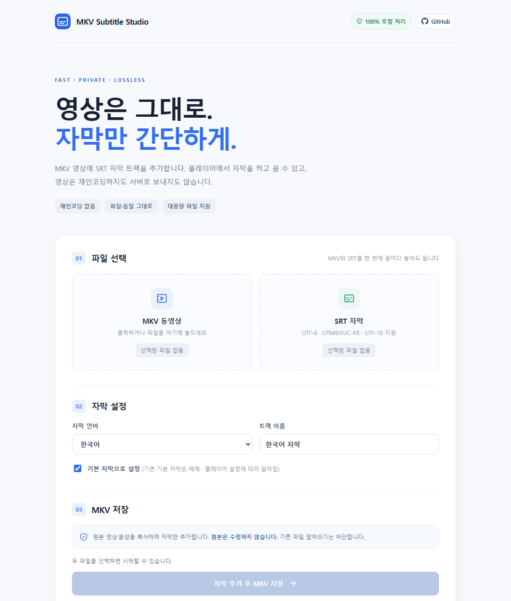

# MKV Subtitle Studio

[](https://github.com/godxxy1229/mkv-subtitle-studio/actions/workflows/tests.yml)

MKV 영상에 SRT 자막 트랙을 추가하는 브라우저 도구입니다. 영상은 재인코딩하지 않고 어디에도 업로드하지 않습니다. 만들어진 MKV에서는 플레이어로 자막을 켜고 끌 수 있습니다.

*Add an SRT subtitle track to an MKV file right in your browser — no upload, no re-encoding.*

**▶ 바로 사용하기: https://godxxy1229.github.io/mkv-subtitle-studio/**



> [!NOTE]
> **v0.2.0 베타**입니다. 단위 테스트, 실제 짧은 MKV 통합 테스트, 3시간 길이 합성 영상 테스트는 통과했지만 수십 GB 실제 파일과 브라우저 전체 저장 흐름은 아직 검증하지 못했습니다. 중요한 원본은 따로 보관하세요. → [검증 결과](docs/TEST_RESULTS.md)

## 기능

- MKV 1개와 SRT 1개로 자막 트랙이 추가된 새 MKV를 만듭니다.
- 영상·음성 데이터는 그대로 복사합니다(재인코딩 없음).
- SRT를 `S_TEXT/UTF8` 소프트 자막으로 추가하고 언어, 트랙 이름, 기본 자막 여부를 지정할 수 있습니다. 새 자막을 기본으로 지정하면 기존 자막의 기본 표시만 해제하고 영상·음성 설정은 유지합니다.
- 자막 인코딩: UTF-8, CP949/EUC-KR, BOM이 있는 UTF-16 LE/BE.
- 지원 브라우저에서는 4 MiB 단위로 디스크에 바로 저장하므로, 큰 영상도 전체를 메모리에 올리지 않습니다.
- 드래그앤드롭(두 파일 한 번에 가능), 진행률 표시, 작업 취소.
- 원본과 같은 파일명이나 이미 내용이 있는 파일에는 저장하지 않습니다(덮어쓰기 차단).

포함하지 않는 기능: SRT 외 자막 형식(ASS 등), 트랙 삭제·교체, 폰트 첨부, 미리보기, 자막 생성·번역, 인코딩, 일괄 처리.

## 사용법

1. 데스크톱 Chrome 또는 Edge에서 [사이트](https://godxxy1229.github.io/mkv-subtitle-studio/)를 엽니다.
2. `.mkv` 영상과 `.srt` 자막을 선택하거나 끌어다 놓습니다.
3. 자막 언어, 트랙 이름, 기본 자막 여부를 정합니다.
4. **자막 추가 후 MKV 저장**을 누르고 새 파일 이름을 정합니다.
5. 결과 MKV를 플레이어에서 열어 자막 표시, 싱크, 탐색을 확인합니다.

새 MKV 크기만큼 디스크 여유 공간이 필요합니다. 저장 중에는 탭을 닫거나 PC를 절전 상태로 두지 말고, 입력·출력 파일을 다른 프로그램에서 건드리지 마세요. 작업이 실패하거나 취소되면 선택한 위치에 빈 파일이 남을 수 있습니다. 기존 파일을 덮어쓰지는 않습니다.

## 지원 브라우저

| 브라우저 | 저장 방식 | 처리 가능한 크기 |
| --- | --- | --- |
| 데스크톱 Chrome · Edge | 디스크에 바로 저장 | 디스크 여유 공간까지 |
| Firefox · Safari · 모바일 브라우저 | 메모리에서 만든 뒤 다운로드 | 입력·출력 각 256 MiB 이하 |

디스크 직접 저장은 브라우저가 [`showSaveFilePicker`](https://developer.mozilla.org/en-US/docs/Web/API/Window/showSaveFilePicker)를 지원하고, 페이지가 HTTPS나 localhost로 열렸을 때만 동작합니다. HTML 파일을 더블클릭해서(`file://`) 열면 동작하지 않습니다.

## 개인정보

모든 처리는 브라우저 안에서 이루어집니다. 업로드 서버, 외부 CDN, FFmpeg.wasm, 분석·추적 코드가 없습니다. `index.html`의 Content-Security-Policy가 `connect-src 'none'`으로 페이지의 네트워크 요청을 막고 있으며, 브라우저 DevTools의 Network 탭에서 영상이 전송되지 않는 것을 직접 확인할 수 있습니다.

## 제한 사항

- SRT는 최대 16 MiB, 50,000구간까지 지원하며 시간순으로 정렬되어 있어야 합니다. UTF-16은 BOM이 필요하고, 한글 인코딩 자동 판별이 모든 파일에서 정확하다고 보장하지는 않습니다.
- 안전을 위해 다음 MKV는 거부합니다: 크기를 알 수 없는 Cluster, 잘린 파일, 여러 Segment나 Cues, 시간이 역순인 Cluster, Position/PrevSize/ReferenceFrame 같은 위치 의존 요소, 지나치게 큰 메타데이터.
- 모든 Matroska 변종을 지원하지는 않으며 MKVToolNix를 대체하지 않습니다.
- 자막 시각은 파일의 Segment 시간축을 기준으로 합니다. 특수한 시간 배율, 음수 시각, linked Segment, ordered chapter는 추가 검증이 필요합니다.
- 영상 길이를 넘는 자막은 플레이어가 무시할 수 있고, 자막 스타일과 기본 트랙 선택은 플레이어 설정에 따라 다릅니다.

## 동작 방식

순수 JavaScript로 EBML/Matroska 구조를 읽고 Tracks, SeekHead, Cues를 새로 구성합니다. Info, 첨부파일, 챕터, 태그는 원본 데이터를 그대로 복사합니다. 위치가 바뀌어 무효가 되는 상위 CRC와 패딩은 제거하고, 기존 Cue의 Cluster 위치는 다시 계산합니다. 원본 전체를 읽어 새 파일로 쓰기 때문에 처리 시간은 파일 크기에 비례합니다.

| 파일 | 역할 |
| --- | --- |
| `src/ebml.js` | EBML 요소 읽기·쓰기 |
| `src/mux.js` | MKV 구조 검사, 출력 계획, 스트리밍 쓰기 |
| `src/subrip.js` | SRT 인코딩 판별과 파싱 |
| `src/safety.js` | 덮어쓰기 방지 검사 |
| `src/app.js` | 화면 동작 |

## 문제 신고

[Issues](https://github.com/godxxy1229/mkv-subtitle-studio/issues)에 남겨 주세요. 다음 정보가 있으면 원인을 찾기 쉽습니다.

- 브라우저와 버전, 운영체제
- 화면에 표시된 오류 메시지
- 원본 MKV 구조: `ffprobe -v error -show_format -show_streams 파일.mkv` 또는 `mkvinfo 파일.mkv` 출력
- 자막 문제라면 문제가 되는 SRT 구간 몇 줄

영상 원본은 첨부하지 마세요. 개인 파일이나 저작권이 있는 콘텐츠가 공개될 수 있습니다.

## 개발

Node.js 20 이상이 필요합니다. 런타임 의존성이 없어 `npm install`은 필요하지 않습니다.

```sh
npm run serve             # http://localhost:8000
npm test                  # 단위 테스트
npm run test:integration  # 실제 MKV 통합 테스트 (ffmpeg, ffprobe 필요)
npm run test:long         # 3시간 길이 합성 영상 테스트 (ffmpeg, ffprobe 필요)
```

`main`에 push하면 GitHub Actions가 테스트를 거쳐 GitHub Pages로 배포합니다. 배포 설정과 직접 호스팅 방법은 [DEPLOY.md](DEPLOY.md), 변경 이력은 [CHANGELOG.md](CHANGELOG.md)를 참고하세요.

## 참고

[MKV Fast Muxer](https://github.com/11576865/MKV-Fast-Muxer)의 사용 목적에서 영감을 받은 독립적인 최소 구현이며, 해당 프로젝트의 소스 코드를 복사하지 않았습니다.

- Matroska specification: https://www.matroska.org/technical/elements.html
- File System Access API: https://developer.mozilla.org/en-US/docs/Web/API/Window/showSaveFilePicker

## 라이선스

[MIT](LICENSE)
